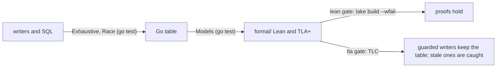

# statemachine

A stored record's lifecycle, written down once as a table: the states a
record may start in, and the successors of each state. Every write of the
state consults the table, tests drive the real writers through it, and the
table is rendered into a Lean model and a TLA+ model that the `lean` and
`tla` gates of lateregate check.

A lifecycle kept only in the code that writes it is an implicit state
machine: each writer applies its own rule, and nothing says which rule is
the right one. Two writers that disagree, or one that checks a state it
read before another writer moved the record, take the record along a step
nobody meant it to have.

## Declare a table

```go
type Status string

const (
	Pending  Status = "pending"
	Approved Status = "approved"
	Denied   Status = "denied"
	Expired  Status = "expired"
	Consumed Status = "consumed"
)

var Devices = statemachine.Must(statemachine.New("Device", []Status{Pending}, map[Status][]Status{
	Pending:  {Approved, Denied, Expired},
	Approved: {Consumed, Expired},
	Denied:   nil,
	Expired:  nil,
	Consumed: nil,
}))
```

Every state is a key, terminal states included, so a misspelled target is
an error. `New` also refuses a state no path from an initial state reaches.
The name is the model's name in Lean and TLA+. A state is the stored wire
value itself, in any case, so the table's type is the column's type.

## Write the state

A table guards a write only when the state it is checked against is the
state the write lands on. Use one of two shapes:

```go
// Read under a row lock in the transaction that writes, then check.
var from Status
err := tx.QueryRow(ctx, `SELECT status FROM devices WHERE id = $1 FOR UPDATE`, id).Scan(&from)
...
if err := Devices.Check(from, Approved); err != nil {
	return err // wraps statemachine.ErrIllegalTransition
}
_, err = tx.Exec(ctx, `UPDATE devices SET status = $2 WHERE id = $1`, id, Approved)
```

```go
// Or make the table's sources the write's condition, and count the rows.
tag, err := db.Exec(ctx,
	`UPDATE devices SET status = $2 WHERE id = $1 AND status = ANY($3)`,
	id, Approved, Devices.Sources(Approved))
...
if tag.RowsAffected() == 0 {
	return fmt.Errorf("approve %s: %w", id, statemachine.ErrIllegalTransition)
}
```

Never check a state read earlier, outside the transaction that writes, and
then write by id. Between the read and the write another writer may have
moved the record, and the write then takes it along a step the table does
not have. The TLA+ model below shows that trace for each table.

Keep one writer function per state column, so there is one place to hold
to the table.

## Test the writers

`statemachinetest.Exhaustive` puts a record in each state and asks the
service's own writer for every other state. A step the table has must land;
anything else must be refused with `statemachine.ErrIllegalTransition` and
leave the record where it was. `statemachinetest.Race` starts two writers at
once on a record in each state, for every pair of its successors, and
checks that the outcome is explained by the table's steps. Run both against
the real store, so the SQL is what is tested:

```go
func TestDeviceWriters(t *testing.T) {
	d := statemachinetest.Driver[Status]{
		Enter: func(t *testing.T, s Status) string { return insertDevice(t, db, s) },
		Move:  func(id string, to Status) error { return store.MoveDevice(ctx, db, id, to) },
		State: func(t *testing.T, id string) Status { return readStatus(t, db, id) },
	}
	statemachinetest.Exhaustive(t, Devices, d)
	statemachinetest.Race(t, Devices, d)
}
```

## The formal models

`statemachinetest.Models` renders every table into one directory,
conventionally `formal/` at the repository root:

| File | What it is |
|---|---|
| `Statemachine.lean` | The table semantics and the lemmas proved once for every table: a path that starts in a closed set stays in it, nothing follows a terminal state, and any number of guarded writers, in any order, move a record only along the table's steps |
| `Machines/<Name>.lean` | The table as a Lean inductive type and step function, with two claims proved by `decide`: every state is reached from an initial state, and each terminal state has no successor |
| `Proofs/<Name>.lean` | Claims about the table, written by hand (not rendered) |
| `Transition.tla` | The TLA+ model: one stored state and several writers, each reading the state, choosing a successor of what it read, and writing it |
| `<Name>.tla`, `<Name>.cfg` | The table for the model, with writers that check the state they land on: TLC must find that every change of state is a step of the table |
| `<Name>.stale.cfg` | The same table with writers that check a state read earlier. TLC must find the trace that leaves the table, and the gate fails if it stops finding one. Rendered only for tables where such a trace exists |
| `lakefile.toml`, `lean-toolchain`, `lake-manifest.json`, `.gitignore` | The Lake project, on the pinned Lean release |

Render the models from a test, with an `-update` flag:

```go
var update = flag.Bool("update", false, "rewrite the formal models under formal/")

func TestFormalModels(t *testing.T) {
	statemachinetest.Models(t, "../../formal", *update, Devices.Graph(), Invitations.Graph())
}
```

```sh
go test ./internal/store -run TestFormalModels -update
```

Without `-update`, the test fails on any difference between the tables and
the committed models, names each file, and says to rerun with `-update`.

### Write a claim

A claim about a table is a theorem in `Proofs/<Name>.lean`. Most are a
finite check over the rendered table, closed by `decide`, carried to every
path by a lemma of `Statemachine.lean`:

```lean
import Machines.Device

namespace Proofs.Device
open Machines.Device Statemachine

/-- A denied request is never approved. -/
theorem denied_never_approved (s : State) (r : Reaches machine .denied s) :
    s ≠ .approved := by
  have := machine.terminal_stays terminal_denied r
  subst this; decide

/-- Once approved, a request is never pending or denied again. -/
theorem approved_stays_decided (s : State) (r : Reaches machine .approved s) :
    s ∈ [State.approved, .consumed, .expired] :=
  machine.reaches_closed (by decide) r (by decide)

end Proofs.Device
```

The rendered lakefile builds `Proofs` only once it has a file, so rerun
the test with `-update` after adding the first one.
[`statemachinetest/testdata/formal`](statemachinetest/testdata/formal) is a
complete example, checked by this repository's own gates.

### Model a protocol that is not a table

Some correctness lives in timing, not in a state column. One example is a
lease that must end before another replica may take the same work. Write
such a protocol by hand as `formal/<Name>.tla` with its `.cfg` beside it;
`Models` leaves files without its header alone. Keep the numbers out of
the hand-written spec: a test renders them from the Go constants into a
module of their own, fails on any difference, and rewrites it under
`-update`:

```go
func TestOutboxConstants(t *testing.T) {
	want := fmt.Sprintf("---- MODULE OutboxConstants ----\nLease == %d\nBatch == %d\n====\n",
		NoticeClaimLease/time.Second, NoticeBatchSize)
	// compare with formal/OutboxConstants.tla; write it when -update is set
}
```

Add a second configuration that overrides the constants with values that
break the protocol, marked `\* expect violation: <Invariant>`. The `tla`
gate then fails if the model stops finding the bad trace, as well as if
the real constants stop passing.

## How the code and the models stay in step

The table is the one source. Each link from it fails a check when it
breaks, so a change cannot reach the main branch with the code, the table
and the models disagreeing.



| A change that | Fails |
|---|---|
| lets a writer take a step the table lacks, refuse one it has, or race off the table | `Exhaustive` or `Race`, in the test suite |
| edits the table without rendering the models | `Models`, in the test suite |
| renders a table that breaks a claim in `Proofs/` | the `lean` gate |
| renders a table where guarded writers could leave it, or stale writers no longer can | the `tla` gate |
| leaves a `sorry` in a proof | the `lean` gate, which builds with `--wfail` |
| changes a constant a protocol model reads | the test that renders its constants module, then the `tla` gate |

What the checks cannot see is a write of the state that does not go
through the table: a second `UPDATE ... SET status` somewhere else, or a
state kept in a column the table does not describe. Keep one writer per
state column, put every writer under `Exhaustive` and `Race`, and name the
state type under `enums.go.types` in `.lateregate.yaml`, so the `enum-go`
gate holds every switch over it exhaustive.

## Tools

The `lean` gate builds with the Lean release the rendered
`lean-toolchain` names, and installs elan when `lake` is not on `PATH`.
The `tla` gate runs TLC on a Java runtime it finds from `JAVA_HOME`, `PATH`
or Homebrew's `openjdk`; on macOS, `brew install openjdk`.
